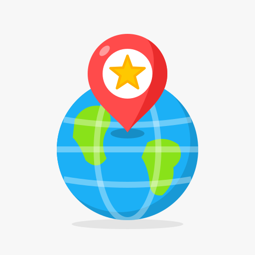

# Giramondo

App per imparare le capitali del mondo in stile Duolingo: si sceglie un continente e si segue un percorso a unità, dalle capitali più famose a quelle meno note, con lezioni sempre più difficili.

**👉 Provala qui: [giramondo.vercel.app](https://giramondo.vercel.app/)**



## Perché esiste

Quest'app è nata per un motivo molto semplice: mi serviva. Cercavo qualcosa per imparare le capitali, ma online o non mi piaceva niente o era tutto pieno di pubblicità. Quindi niente, l'ho fatta io.

Se può essere utile anche a te, tanto meglio! 🤗❤️

## Cosa c'è

- **Percorsi**: Europa, Americhe, Asia, Africa, Oceania (194 stati: membri ONU + Vaticano), più due sotto-percorsi che si sbloccano completando la prima unità del continente: **Capoluoghi d'Italia** (20 regioni) e **Stati Uniti** (50 stati).
- **Lezioni**: ogni unità ha 5 passi — scelta multipla (2 volte, alla prima apparizione la risposta è mostrata), sillabe da comporre, risposta da scrivere, ripasso misto con le unità precedenti e domande al contrario ("di quale paese è capitale…"). Le risposte sbagliate si ripetono in fondo alla lezione.
- **Salta qui**: un test con 3 vite per saltare a un'unità più avanti.
- **Progressi**: XP, giorni di fila, record, città imparate. Tutto salvato nel browser (`localStorage`, chiave `capitali-progress`: il nome storico del progetto, non cambiarla o si perdono i progressi), nessun account né server.
- **Profilo e avatar**: nome e avatar personalizzabile (viso, capelli, barba, vestiti, accessori, sfondo). L'avatar reagisce nelle lezioni (felice / triste) e alcuni oggetti si sbloccano giocando:

  | Oggetto | Come si sblocca |
  |---|---|
  | Cappello da esploratore | completa la prima unità |
  | Cuffia da aviatore | 7 giorni di fila |
  | Corona | 500 XP |
  | Sfondo "mappa" | completa un intero continente |
  | Spille con bandiera | una per ogni paese imparato |

- **Installabile sul telefono**: "Aggiungi a schermata Home" usa l'icona e si apre a schermo intero.

## Avvio

Serve Node 20.19+ o 22.12+ (richiesto da Vite).

```sh
npm install
npm run dev       # sviluppo su http://localhost:5173
npm test          # test (node --test, senza dipendenze)
npm run lint      # oxlint
npm run build     # versione da pubblicare in dist/
npm run preview   # prova la build
npm run icons     # rigenera le icone PNG da public/favicon.svg (usa Google Chrome)
```

Per provarla sul telefono nella stessa rete: `npm run dev -- --host` e apri l'indirizzo "Network" che compare.

## Struttura

| File | Contenuto |
|---|---|
| `src/data.js` | Percorsi, unità e paesi: `[codice ISO per la bandiera, nome, capitale]` |
| `src/game.js` | Logica pura: sillabe, domande, lezioni, sblocchi del percorso, serie di giorni |
| `src/App.jsx` | Schermate: home, percorso, lezione (navigazione nell'hash dell'URL, così funziona il tasto indietro) |
| `src/Profile.jsx` | Profilo ed editor dell'avatar |
| `src/avatarData.js` | L'avatar come dati: parti, colori, varianti di DiceBear (più barba e baffi disegnati qui), condizioni di sblocco |
| `src/Avatar.jsx` | L'avatar disegnato con DiceBear (stile Big Smile), più sfondo e spilla |
| `src/*.test.js` | Test |
| `public/` | Icona (`favicon.svg` è l'originale), PNG per il telefono, manifest |

Bandiere da [flagcdn.com](https://flagcdn.com), font Nunito da Google Fonts: servono la connessione.
Avatar: stile [Big Smile](https://www.dicebear.com/styles/big-smile/) di [DiceBear](https://www.dicebear.com), remix di [Custom Avatar](https://www.figma.com/community/file/881358461963645496) di Ashley Seo, licenza [CC BY 4.0](https://creativecommons.org/licenses/by/4.0/): anche questa attribuzione è in fondo al profilo.

Icone dei passi e del lucchetto da Flaticon: la licenza gratuita chiede l'attribuzione, che nell'app è in fondo al profilo (`src/Profile.jsx`). Nel dettaglio:
[bersaglio](https://www.flaticon.com/free-icons/bullseye) di Vectorsclub;
[manubrio](https://www.flaticon.com/free-icons/gym), [puzzle](https://www.flaticon.com/free-icons/puzzle), [piuma](https://www.flaticon.com/free-icons/pen-drive), [quiz](https://www.flaticon.com/free-icons/quiz) e [lucchetto](https://www.flaticon.com/free-icons/lock) di Magnific.

## Modificare i contenuti

**Paesi e unità** — in `src/data.js` ogni percorso ha delle unità in ordine di importanza:

```js
{ id: 'grandi', title: 'Le grandi capitali', countries: [
  ['it', 'Italia', 'Roma'], ['fr', 'Francia', 'Parigi'],
] },
```

Si possono spostare paesi e unità liberamente; non cambiare però gli `id` delle unità già esistenti, o chi le ha completate perde quei progressi. I test controllano che non ci siano doppioni e che ogni percorso abbia almeno 4 paesi (servono per le 4 opzioni di risposta).

**Avatar** — in `src/avatarData.js` ogni tabella dà un nome italiano a una variante di Big Smile (`corti: 'shortHair'`) o a un colore (`biondi: '#e8b84a'`): aggiungere una voce basta perché compaia nell'editor, e con `unlock: { xp: 1000 }` diventa un oggetto da sbloccare. Le varianti esistenti sono nel [playground di DiceBear](https://www.dicebear.com/playground/?style=big-smile). Barba e baffi non sono in Big Smile: sono disegnati in fondo allo stesso file, nelle coordinate della testa; la barba ha una variante per ogni bocca, perché la contorna. Gli avatar salvati con opzioni che non esistono più tornano al valore predefinito.

**Icona** — si modifica `public/favicon.svg`, poi `npm run icons`. Sul telefono va tolta e riaggiunta alla schermata Home per vedere la nuova.
